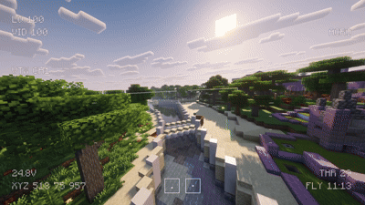

Found a cool spot to fly into, but can't get inside because the map author kindly closed every door? Say no more. No need to switch back to the player - the drone can now fly straight through closed doors, glass and other blocks, just like in spectator mode.

## Usage
1. Open the Propwash FPV configuration menu (K by default).
2. Go to the "Modes" menu.
3. Bind Noclip mode to any key you want.

## Requirements
- Propwash FPV 0.5.0+
- Fabric 0.160.6+26.3+
- Neoforge 26.3.0.10-beta+
